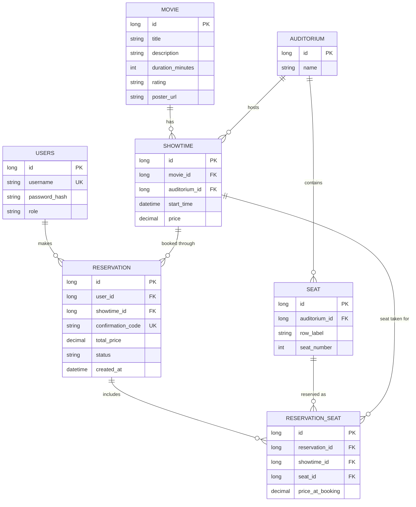

**Constraints**
- `USERS.username` is unique.
- `SEAT` is unique on (auditorium_id, row_label, seat_number).
- `RESERVATION.confirmation_code` is unique.
- `RESERVATION_SEAT` is unique on (showtime_id, seat_id). This is the seat rule.